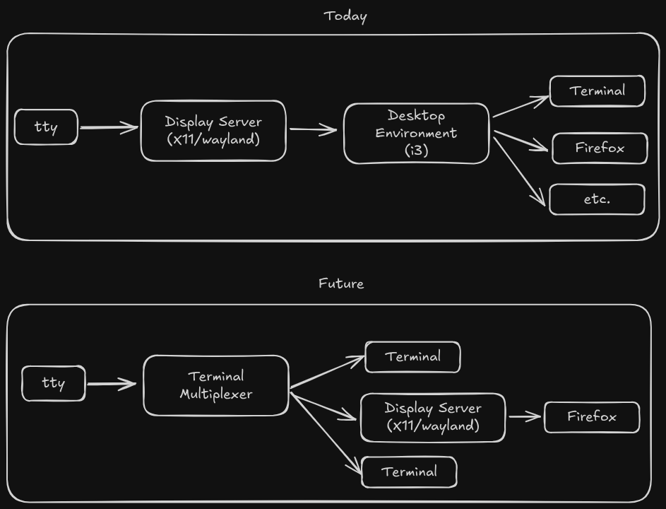

# ratspace

What if your terminal managed more than just text? What if your whole desktop was just a terminal?

I'm building this live!

- https://www.youtube.com/@orhundev
- https://www.twitch.tv/orhundev

## Design

> TTY → Ratspace
                ├─ PTY-backed terminal panes
                └─ GUI pane ↔ nested compositor ↔ Firefox

> TTY login
>    │
> Ratspace session: shell + command lifecycle
>    ├─ text command ──> terminal renderer ──> display
>    └─ GUI command ───> Wayland runtime  ───> same display
>                                                  │
>                                       app exits ─┘

## Terminal Renderer

The `ratatui-smithay` workspace crate rasterizes Ratatui cells into a damage-tracked Smithay buffer. It uses Parley for shaping and Swash glyph rasterization, then caches glyph masks and repaints changed cells.
